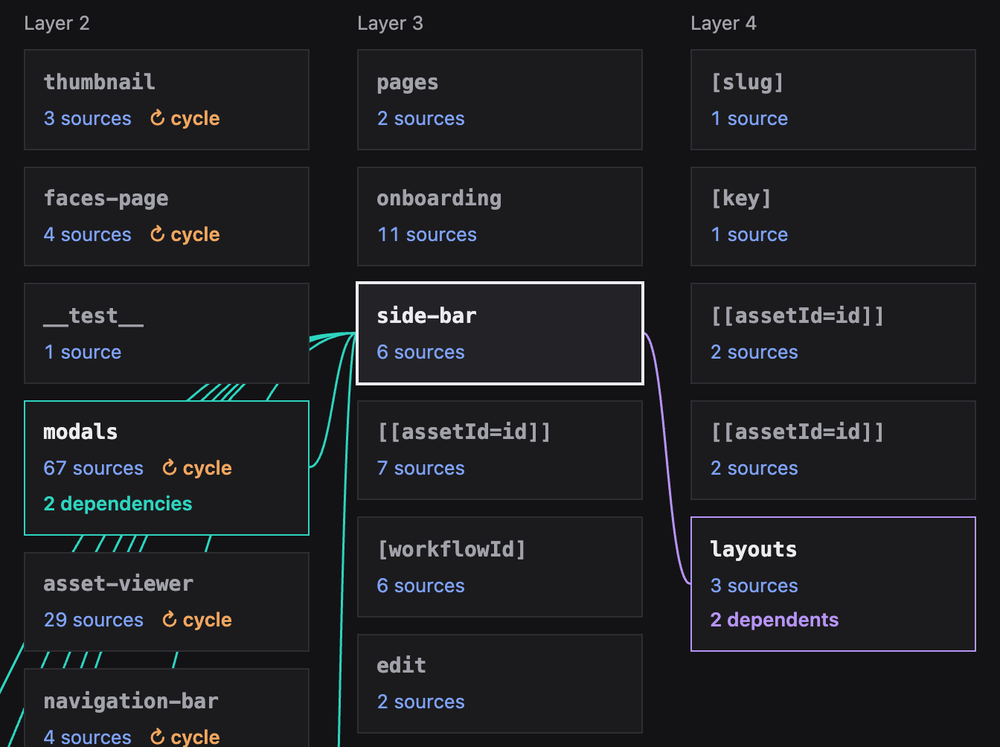

# Galactica

Galactica maps imports in JavaScript and TypeScript repositories. Browse the dependency graph in an offline HTML file, or use the CLI to find what a change affects and which tests cover it.



## Quick start

Requires Node.js 24.1.0 or newer. From a project you trust, open a dependency map with one command.

```sh
npx @cognitap/galactica html --open
```

Galactica writes `galactica.html` in the current directory and opens it in your browser. Select a folder to see its modules, or select a file to trace what it imports and what depends on it. The map is a single HTML file you can share or open offline.

For regular use, install the CLI globally and run the same commands as `galactica`.

```sh
npm install -g @cognitap/galactica
galactica html --open
```

To inspect an unfamiliar checkout, run Galactica from a trusted directory and pass `--root /path/to/checkout`. [How Galactica reads repositories safely](https://github.com/cognitap/galactica/blob/main/docs/security.md)

## Use it with a coding agent

Run `npx @cognitap/galactica init` in your own repository (or `galactica init` after a global install) to install the skill for Codex, Claude Code and Cursor. Ask your agent which files and tests a change could affect. The skill uses the same import graph as the HTML map and points the agent toward feature-name searches for tests loaded at runtime.

## CLI

| Command          | What it shows                                             |
| ---------------- | --------------------------------------------------------- |
| `overview`       | Packages, areas and dependency layers                     |
| `where <name>`   | Definitions of a named symbol                             |
| `outline <file>` | A file’s exports and signatures                           |
| `uses <file>`    | Importers and tests that reach the file                   |
| `deps <file>`    | The file’s dependencies                                   |
| `cycles`         | Import cycles and where to break them                     |
| `health`         | Cycles, oversized areas and cross-package private imports |

Add `--json` for structured output. Test reach follows imports, so tests that load code at runtime may need a separate search. [Command reference](https://github.com/cognitap/galactica/blob/main/docs/commands.md) · [Configuration](https://github.com/cognitap/galactica/blob/main/docs/configuration.md)

## Agent benchmark

We ran six tasks on Hono, Vite and NestJS with Sonnet and Opus. The clearest benefit came when agents had to name the tests that exercise an edited file in Hono or Vite.

| Share of required tests named on those two tasks | Without Galactica | Instructed to use the skill |
| ------------------------------------------------ | ----------------: | --------------------------: |
| Sonnet                                           |               47% |                         78% |
| Opus                                             |               82% |                        100% |

The Hono task shows why following imports matters. Four adapter tests reach the edited function through a package import. Opus missed all four on each baseline run. With the skill instruction, it named all 12 required tests on every run.

All three conditions scored 100% on the other four tasks. Across all six, instructing the models to use Galactica increased average cost per run by 7% for Sonnet and 17% for Opus. The study covered 144 runs, four per task, model and condition. Grading checked edits statically and gave credit for required tests named. Extra tests carried no penalty, and the target test suites were never executed. [Full results, method and limitations](https://github.com/cognitap/galactica/blob/main/docs/benchmark.md)

Galactica 0.x is experimental and published under `latest`. [Release policy](https://github.com/cognitap/galactica/blob/main/RELEASE_POLICY.md)

The map was inspired by [codemap](https://github.com/peterretief/codemap). MIT licensed.
